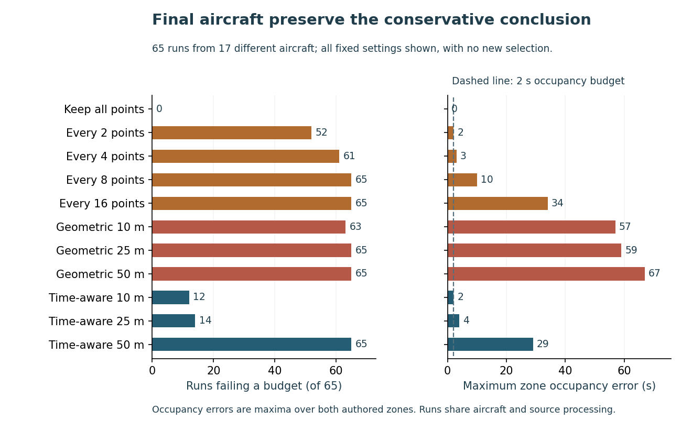

# Keep flight replay timing accurate when reducing trajectory storage

Flight replay and reporting tools can draw a convincing route while placing an aircraft at the wrong point at a given time. This study tests whether reducing trajectory points preserves route length and time spent inside defined zones, alongside the point-record storage reduction.

**Finding: under the authored budgets, keep the original point records.** Every tested setting that removes points fails at least one development run, so the selector keeps all points. The [frozen final comparison](FINAL_NOTE.md) applies that choice to 17 different aircraft; all other settings remain descriptive comparisons.

| Final setting | Point-record bytes retained | Runs failing a fixed budget |
|---|---:|---:|
| Keep every point, selected before final scores | 100% | 0 / 65 |
| Every fourth point | 25.3% | 61 / 65 |
| Geometric tolerance 25 m | 8.1% | 65 / 65 |
| Time-synchronous tolerance 10 m | 33.0% | 12 / 65 |

The authored limits are 25 m time-aligned position error, 1% horizontal route-length error and 2 seconds on two zone queries, applied to each run. Geometric 25 m reaches 1,038.37 m of time-aligned error. Time-synchronous 10 m meets position/timing limits but fails route length on twelve final runs. These example requirements do not rule out another grid or application; the route metric preserves a processed reference, not proven physical motion. The licensed TrajAir slice contains 106 usable runs from 30 aircraft, with 13 development and 17 final aircraft. [Source checks](SOURCE_BINDING.md) retain the exact source, split and exclusions. Its tracks are filtered and interpolated observations, not airline schedules or a live safety system. Aircraft identifiers and coordinate records stay outside Git.

Read the [six-page independent study](paper/manuscript.pdf) for the decision, complete grid, methods, figures and limitations. It is not peer reviewed.

The [protocol](PROTOCOL.md) defines eleven retained configurations, simple baselines, aircraft-separated development and final evaluation, fixed spatial/timing/route budgets, and independent source and numerical checks. The [source plan](data/source_plan.json) fixes the archive and scene-selection rule before retrieval. [Source rights and privacy](DATA_RIGHTS.md) describe attribution and the publication boundary.

Try the [offline implementation exercise](examples/README.md): a straight route can keep its length while replaying a zone exit 75 seconds early. The teaching records are authored, separate from the aircraft benchmark. No new compression algorithm, actual airline delay, production adoption, safety guarantee or financial saving is claimed.

## Reproduce the result

~~~sh
python -m pip install -r requirements.txt
python src/capture_source.py --out .source/7days1.zip --receipt .source/capture.json --protocol-commit e17b0aab0d3ed6d45de1965d111a0f30f514f152 --expected-sha256 d058adbbc19393bdb08ace91e0505933c858b626e5098ed87dd7645ab045485c
python src/replay.py --archive .source/7days1.zip --work .source/replay --receipt .source/replay-receipt.json
~~~

Use a full-history clone and fresh output paths. The first source command makes an ordinary unauthenticated request to the separately licensed public Figshare file, checks its exact bytes and refuses to overwrite a prior capture. Retain a failed capture and its receipt; do not repeatedly retry a source denial. The subsequent analysis runs offline. Source archives, coordinates and temporary payloads remain in ignored paths; do not upload those directories or CI artifacts.

The independent source checker reparses every qualified point using a separate ZIP reader, SQLite run boundaries and Decimal unit checks. The numerical checker decodes the actual retained payloads, checks every point diagnostic and split tree, and independently recomputes metrics, query states, summaries and selection. Source, counts, retained indices, query times, states and guards are exact; the declared float tolerances and runtime-specific diagnostic-hash policy are in [the environment notes](ENVIRONMENT.md). The 34 analytical dependencies remain frozen.

Two separate full-history analysis clones passed on Python 3.10.11 and 3.12.14 with NumPy 2.2.5: 168,193 exact facts and 16,863 numeric facts each, plus independently decoded runtime-specific hashes. The source archive stayed unchanged. There are 34 fixture methods and three authored cases with 18 closed-form checks. Three inspected figures bind 470 source values, 778 SVG coordinates, 44 individual numeric labels and nine file hashes; the manuscript binds 66 values in 300 checks. All six current PDF pages were rendered and inspected. These finite checks do not prove universal correctness or accessibility conformance.

Exact candidate/main Linux CI, matching trees, annotated release tag and publication checks belong to the selected revision: see [PR 2](https://github.com/S3R3Bii/flight-compression-query-audit/pull/2), [Actions](https://github.com/S3R3Bii/flight-compression-query-audit/actions) and the [review receipt](REVIEW_RECEIPT.json).

## Interpretation and source credit

TrajAir is by Jay Patrikar, Brady Moon, Sourish Ghosh, Jean Oh and Sebastian Scherer, with [official documentation](https://theairlab.org/trajair/) and [dataset DOI](https://doi.org/10.1184/R1/14866251.v1), licensed CC BY 4.0. Cohort selection, gap splitting, metre conversion and derived metrics are modifications. The code is MIT licensed; see [source rights](DATA_RIGHTS.md). Douglas–Peucker and time-aligned trajectory simplification are established methods, not new algorithms introduced here.

The 1% route-length budget could preserve source fluctuations alongside useful movement. Its operational suitability is uncalibrated. Aircraft separation does not remove shared airport, weather or processing dependence. This cohort is a convenience slice and the grid is finite. No measured safety, airline-delay, latency, production saving, deployment or causal-generalization result follows. Raw source records, identifying fields, credentials and formal-publication projects such as Azure optimization remain private.
